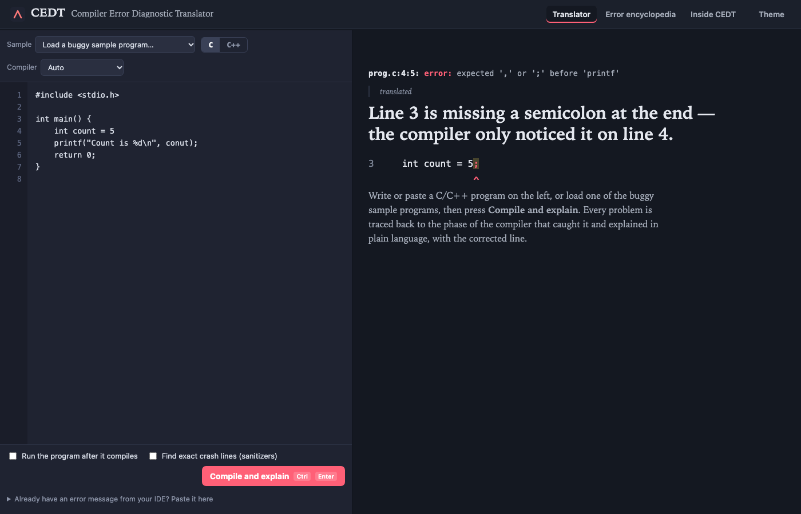
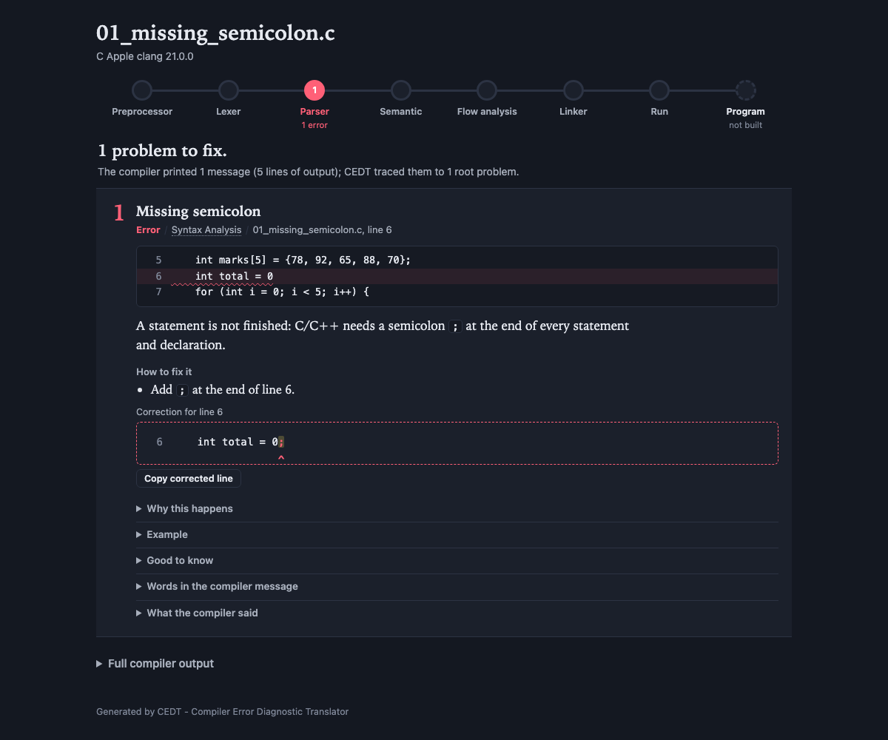

# CEDT — Compiler Error Diagnostic Translator

**A Beginner-Friendly Error Interpretation Layer for C/C++**

BCSE307L Compiler Design — Project 16 · Final review: 30.10.2026

By **Arbind Agarwal** (24BCE2640), VIT.

> **Built with AI.** This project was made with **Claude** (Anthropic's AI model), using Claude Code.
> Most of the code, rules, tests and documentation were written by Claude, directed and reviewed by me.



<details>
<summary>Stand-alone HTML report (<code>python cedt.py prog.c --html report.html</code>)</summary>



</details>

---

## 1. What is the problem?

When a beginner forgets one semicolon, GCC says:

```
marks.c: In function 'main':
marks.c:7:5: error: expected ',' or ';' before 'for'
    7 |     for (int i = 0; i < 5; i++) {
      |     ^~~
marks.c:7:21: error: 'i' undeclared (first use in this function)
marks.c:7:21: note: each undeclared identifier is reported only once for each function it appears in
marks.c:7:31: error: expected ';' before ')' token
...                                  (5 messages in total)
```

Three problems for a beginner:

| Problem | Example |
|---|---|
| **Jargon** | "expected ',' or ';' before 'for'", "lvalue required", "undefined reference", "stray '\342' in program" |
| **Wrong line** | The semicolon is missing on line **6**, but the compiler reports line **7** (it only notices when it reads the next token) |
| **Avalanche** | One mistake → many messages (follow-on errors from the parser's error recovery). The student fixes the wrong one first |

## 2. What does CEDT do?

CEDT is an **interpretation layer**: it does **not** replace GCC or Clang. It runs the real compiler, then
**reads the compiler's output like a compiler reads a program** — lexical analysis, LL(1) parsing,
semantic analysis — and turns it into a plain-language explanation:

```
[1] ERROR  Missing semicolon                                        Syntax Analysis
    marks.c line 6   (the compiler pointed at line 7)
         5 |     int marks[5] = {78, 92, 65, 88, 70};
    >    6 |     int total = 0
         7 |     for (int i = 0; i < 5; i++) {

    Line 6 (`int total = 0`) does not end with a semicolon. The compiler only noticed the
    problem when it reached `for` on line 7, so it reported line 7.
    How to fix:
      - Add `;` at the end of line 6.
    Corrected line 6:
      -     int total = 0
      +     int total = 0;
    + 4 more compiler message(s) caused by this problem (they should disappear after the fix)
```

For every message CEDT gives: **what** went wrong, **the real line**, **why** it usually happens,
**how to fix it**, a **corrected line**, and a **wrong/right example** — and it folds follow-on errors under
their root cause.

## 3. Results (real GCC 13 / Clang 18 output — `docs/evaluation.md`)

| Metric | Plain compiler | CEDT |
|---|---|---|
| Points at the line of the actual bug (held-out set, unseen programs) | 82.1% | **100%** |
| Points at the line of the actual bug (development set, 270 cases) | 85.9% | **100%** |
| When the compiler blamed the wrong line, CEDT found the right one | — | **48 of 48** |
| Messages the student must read (development set) | 377 | **272** (−27.9%) |
| Bugs the compiler is completely silent about (off-by-one, `x^2`, missing `break`…) | 0 of 17 | **17 of 17** |
| Planted mistake identified as problem #1 — held-out, blind first run | — | **95.0%** |
| Planted mistake identified as problem #1 — held-out, after adding 2 missing rules | — | **100%** |
| Readability (Flesch Reading Ease, higher = easier) | 54–58 | **84–85** |
| Time CEDT adds per program | — | **~1 ms** (compiler itself: ~140 ms) |

*What this means:* a student using CEDT is always taken to the right line, reads about a quarter fewer
messages, and gets explanations written at "plain English" reading level. The held-out set (30 programs
written after the rules were finished) is the honest estimate for unseen code.

## 4. Quick start

**Requirements:** Python 3.8+ (no extra packages) and GCC or Clang.

| OS | Install a compiler |
|---|---|
| Windows | MSYS2/MinGW-w64 (or the GCC that comes with Code::Blocks / Dev-C++) — make sure `gcc` works in cmd |
| macOS | `xcode-select --install` (Apple clang; `gcc` is clang on macOS) |
| Linux | `sudo apt install build-essential clang` |

```bash
# explain a program (compiles it with gcc/clang automatically)
python cedt.py samples/c/01_missing_semicolon.c

# C++ / choose the compiler
python cedt.py samples/cpp/02_cin_wrong_arrow.cpp --compiler clang

# also RUN the program and explain crashes (segfault, divide by zero, infinite loop...)
python cedt.py samples/c/24_divide_by_zero.c --run --input "10 0"
python cedt.py samples/c/24_divide_by_zero.c --run --input "10 0" --sanitize   # exact crash line

# web interface (editor + explanations + "Inside CEDT" compiler-design views)
python cedt.py --web          # opens http://127.0.0.1:8000

# explain an error log copied from an IDE (Code::Blocks, VS Code, Dev-C++ ...)
gcc prog.c 2> errors.txt
python cedt.py --log errors.txt --source prog.c

# save a stand-alone HTML report
python cedt.py prog.c --html report.html
```

Use `python3` instead of `python` on macOS/Linux. Run `python cedt.py --help` for all options.

### Compiler-design views (for the viva)

```bash
python cedt.py --grammar                      # LL(1) grammar, FIRST/FOLLOW sets, parsing table
python cedt.py --diag-tokens errors.txt       # tokens of the compiler output (lexical analysis)
python cedt.py --trace errors.txt             # step-by-step LL(1) parse (stack / input / action)
python cedt.py --tokens prog.c                # tokens of the C program (CEDT's own DFA lexer)
python cedt.py --symbols prog.c               # scope-aware symbol table + bracket report
python cedt.py --list-rules                   # the knowledge base
python cedt.py --explain S001                 # one rule in full
```

### Tests and evaluation

```bash
python -m unittest discover -s tests -v       # 76 tests
python tools/evaluate.py --heldout --live     # reproduces every number in section 3
```

On macOS one live test (`test_samples_with_every_compiler`) fails: Apple's libc++ reports
`samples/cpp/03_vector_no_include.cpp` and `09_count_ambiguous.cpp` differently from GCC's libstdc++,
so those two samples aren't explained there. This is a macOS-only difference; the other 75 tests pass on a Mac.

On Apple Silicon an integer divide by zero doesn't crash, so `--run` adds
`-fsanitize=integer-divide-by-zero` automatically on ARM Macs.

## 5. How it works

```
 student's program ──► GCC / Clang ──► raw compiler output
        │                                    │
        │                    ┌───────────────▼────────────────┐
        │                    │ 1. Diagnostic LEXER            │  regex token classes + start
        │                    │    (diag_lexer.py)             │  conditions, like Lex
        │                    ├────────────────────────────────┤
        │                    │ 2. LL(1) PARSER                │  FIRST/FOLLOW, predictive table,
        │                    │    (ll1.py, diag_parser.py)    │  panic-mode recovery → error tree
        │                    └───────────────┬────────────────┘
        ▼                                    ▼
 ┌──────────────────────────┐   ┌─────────────────────────────────┐
 │ 3. SOURCE ANALYSIS        │   │ 4. KNOWLEDGE BASE (132 rules,   │
 │  C/C++ lexer (DFA)        │──►│    412 GCC+Clang patterns, by   │
 │  bracket matcher (stack)  │   │    compiler phase) + HANDLERS   │
 │  symbol table (scopes)    │   │    that read the source code    │
 └──────────────────────────┘   └───────────────┬─────────────────┘
        │                                        ▼
        │                     ┌────────────────────────────────────┐
        └────────────────────►│ 5. PRECHECKS: 14 silent-bug checks │
                              │ 6. CASCADE: root cause vs follow-on│
                              │ 7. RUNTIME: crash explanations     │
                              └───────────────┬────────────────────┘
                                              ▼
                               terminal · HTML report · web UI · JSON
```

### Where the compiler-design syllabus appears

| Syllabus topic | Where in CEDT | File |
|---|---|---|
| Phases of a compiler | Every explanation is tagged with the phase that detected it; the UI shows a phase tracker | `kb.py`, `render_*.py` |
| Lexical analysis, regular expressions, Lex start conditions | Compiler output is tokenized with prioritized regex classes and states (`SNIPPET`, `MACLINK`) | `diag_lexer.py` |
| DFA, maximal munch | CEDT's own C/C++ scanner; numbers use an explicit table-driven DFA (explains `08`, `2x`) | `source_lexer.py` |
| CFG, FIRST/FOLLOW, LL(1) table, predictive parsing | A general LL(1) generator + table-driven parser parses the compiler's output | `ll1.py`, `diag_parser.py` |
| Error recovery (panic mode) | Used by CEDT's parser (sync on FOLLOW); also explains *why* GCC prints avalanches → cascade analysis | `ll1.py`, `cascade.py` |
| Syntax-directed translation | Action symbols (`@diag`, `@snip`, `@note`…) build the diagnostic tree during parsing | `diag_parser.py` |
| Pushdown automaton | Bracket matcher with a stack + indentation heuristic finds *which* `{` is unclosed | `brackets.py` |
| Symbol table, scopes | Scope-aware table (file → function → block → for) for "did you mean", scope and use-before-declaration explanations | `symbols.py` |
| Semantic analysis / type checking | Handlers reason about types: `%d` vs `double`, `.` vs `->`, `=` vs `==`, string compare | `handlers/semantic.py` |
| Data-flow analysis | Uninitialized variables, missing `break`, off-by-one, integer division | `prechecks.py` |
| Linking / runtime environment | Undefined reference, missing `main`, `-lm`; segfault / SIGFPE / stack smashing explained | `handlers/linker.py`, `runtime.py` |

## 6. Project layout

```
CEDT/
├── cedt.py                 launcher (python cedt.py ...)
├── cedt/
│   ├── diag_lexer.py       lexical analysis of compiler output
│   ├── ll1.py              LL(1) parser generator (FIRST, FOLLOW, table, parser, recovery)
│   ├── diag_parser.py      grammar of compiler output + syntax-directed translation
│   ├── source_lexer.py     C/C++ lexer with a table-driven number DFA
│   ├── brackets.py         stack-based bracket matcher
│   ├── symbols.py          scope-aware symbol table
│   ├── source.py           bundles the source analyses
│   ├── kb.py               knowledge-base loader / matcher
│   ├── data/rules/*.json   132 rules in 7 files, one per phase (add rules without code)
│   ├── data/stdlib.json    which header declares which function
│   ├── data/glossary.json  jargon → plain meaning
│   ├── handlers/           source-aware logic per phase
│   ├── translator.py       the interpretation pipeline
│   ├── prechecks.py        15 checks for bugs the compiler does not report
│   ├── cascade.py          root-cause vs follow-on grouping
│   ├── runtime.py          run the program, explain crashes
│   ├── driver.py           finds and runs gcc/g++/clang/clang++ (Linux, MinGW, macOS)
│   ├── core.py             public API
│   ├── cli.py, render_text.py, render_html.py
│   └── web/                local web interface (standard library only)
├── samples/                37 demo programs (27 C, 10 C++) with one mistake each
├── tests/                  76 unit tests; 138 probe programs + real GCC/Clang outputs;
│                           30 held-out programs
├── tools/evaluate.py       produces docs/evaluation.md
├── tools/make_heldout.py   writes the held-out set
└── docs/                   evaluation results + VIVA_GUIDE.md (review prep: demo script, Q&A, cheat sheet)
```

## 7. Adding a new error rule (no Python needed)

Add an entry to the right file in `cedt/data/rules/`:

```json
{
  "id": "S022",
  "title": "Short title a beginner understands",
  "phase": "syntax",
  "patterns": ["^GCC wording with (?P<name>[^']+) groups$", "^Clang wording$"],
  "what": "Line {line}: plain explanation using {name}.",
  "why": ["Common reason"],
  "fix": ["What to change"],
  "example": {"wrong": "...", "right": "..."},
  "samples": ["an exact compiler message, used by the tests"]
}
```

Then run `python -m unittest discover -s tests`.

## 8. Limitations

* Explanations are rule-based: a message with no matching rule gets a generic "how to read this" explanation
  (1.5% of messages on the held-out set).
* Template-heavy C++ errors are summarized, not fully explained.
* Silent-bug checks are heuristics and can occasionally warn about correct code; they are shown as *tips*.
* English only.

## License

MIT, see [LICENSE](LICENSE).
